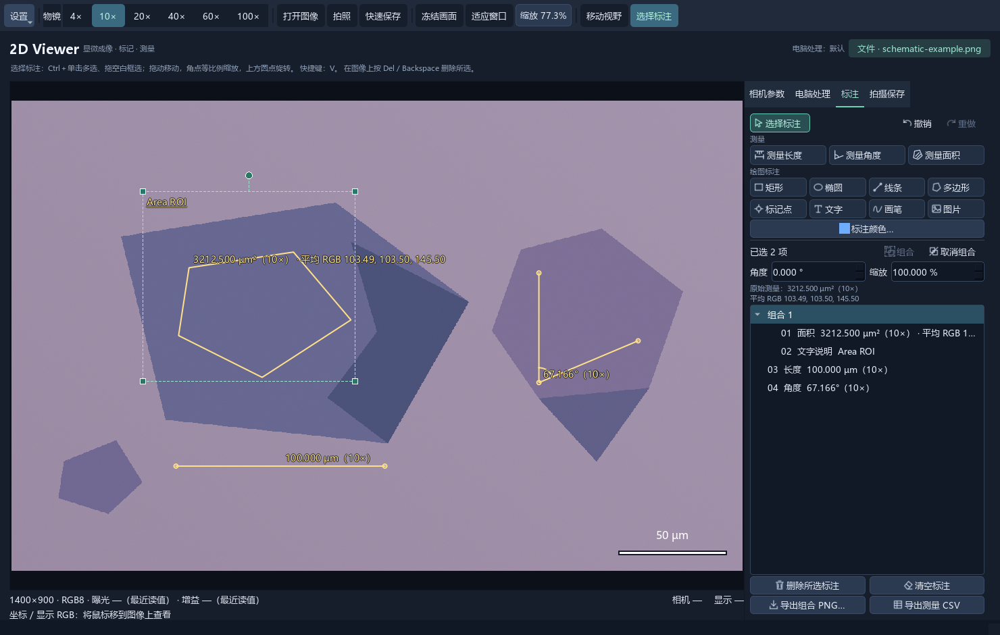
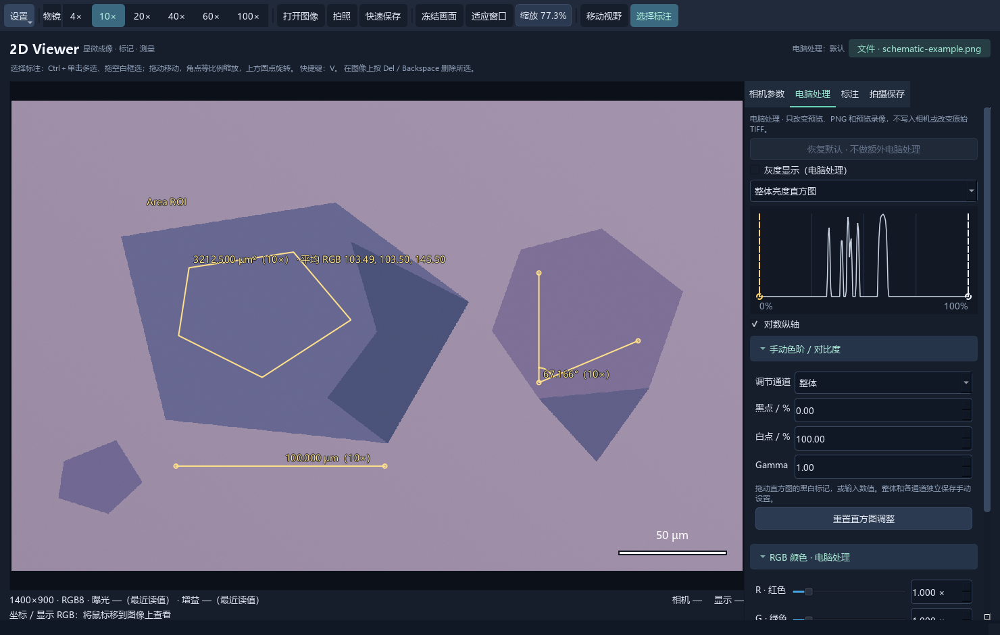

# 2D Viewer

**Optical microscopy, annotation and measurement tools for 2D materials research.**

**English** · [简体中文](README.md)

View microscope images, outline regions of interest, record mean RGB values, measure lengths, areas and angles, and export results in one desktop application. Use a supported FLIR camera for acquisition or open existing images for offline work.

**Current release: 0.14.1 · Windows 11 x64 · The application interface is currently in Chinese**

**[Download the Windows installer](https://github.com/twomatwo/2d-viewer/releases/download/v0.14.1/2D-Viewer-Setup-0.14.1-x64.exe)** · [All releases](https://github.com/twomatwo/2d-viewer/releases) · [Installation guide (Chinese)](https://github.com/twomatwo/2d-viewer/releases/download/v0.14.1/Installation-Guide-zh-CN.html) · [SHA256 checksums](https://github.com/twomatwo/2d-viewer/releases/download/v0.14.1/SHA256SUMS.txt)

## Screenshots



*Captured from the actual application using a synthetic schematic image and illustrative calibration. The image and readings do not represent a real material, thickness or experimental measurement. Temporary settings were used and no camera was connected.*

## Research workflows

- **Compare flake regions:** outline a polygon and record its geometric area and mean RGB values.
- **Document device geometry:** measure lengths, areas and angles while retaining the objective and calibration recorded at creation.
- **Annotate experiments:** add text, shapes and image overlays; group objects and precisely adjust their angle and scale.
- **Share results:** export annotated PNGs, measurement CSV files, or a selected annotation group as a transparent PNG.

## Features

| Feature | Capabilities |
| --- | --- |
| Camera acquisition | Developed for the FLIR Blackfly S BFS-U3-51S5C-C; exposure, gain, white balance and per-objective camera profiles, plus snapshots, video recording and timed capture. |
| Offline viewing | Open existing PNG, JPEG, TIFF and other supported images for viewing, processing, annotation and measurement without a camera. |
| Image processing | Overall and per-channel RGB levels, gamma, channel gains, brightness, contrast, saturation, grayscale, mirroring and rotation, with histogram controls. |
| Measurements | Length, area and three-point angles; area selection also records mean RGB. Measurements retain their creation-time objective and calibration. |
| Annotations and overlays | Rectangles, ellipses, lines, polygons, markers, text, freehand drawing and image overlays; opacity, multiple selection, grouping, precise rotation/scaling, undo and redo. |
| Export and capture | Annotated PNG, original-pixel TIFF, measurement CSV and transparent annotation-group PNG; configurable capture directories and filenames. |
| Recovery and calibration | Per-objective calibration and camera profiles, automatic annotation recovery records, and calibration library import/export. |

### Image processing controls



*The same synthetic schematic in the actual application. These screenshots illustrate the interface and are not performance or accuracy benchmarks.*

## Install and get started

1. Download the [0.14.1 Windows x64 installer](https://github.com/twomatwo/2d-viewer/releases/download/v0.14.1/2D-Viewer-Setup-0.14.1-x64.exe).
2. Close any older version and run the installer. Python, application dependencies and the official Spinnaker 4.4.0.246 offline installer are included. You do not need to install Python separately. If camera runtimes or USB3 drivers are missing, the installer launches the official setup; administrator permission or a restart may be required.
3. Launch **2D Viewer**. For acquisition, connect the camera to a USB3 port and close SpinView or other software using the camera. For offline work, click **打开图像…** (Open image) to load an existing image.
4. Select the physical objective in the top toolbar. Before calibrated measurements, configure a real calibration under **设置 → 物镜与标定** (Settings → Objectives and calibration). Measurement and drawing tools are in the **标注** (Annotations) tab.

The installer targets **Windows 11 x64**. Camera acquisition is developed for the **FLIR BFS-U3-51S5C-C**; compatibility with other camera models has not been established. The release has passed packaged functionality checks and an actual EXE offline-startup check. First-time driver installation on a clean PC has not yet been validated.

## Understanding the measurements

- Mean RGB is sampled from the **displayed base image** when an area selection is completed. Values range from 0 to 255, include computer-side image processing and boundary pixels, and exclude annotation overlays. These are color statistics, not automatic material identification or thickness estimates.
- Physical lengths and areas require a real calibration; otherwise results use pixel units. For a three-point angle, the second point is the vertex and the result is between 0° and 180°.
- Measurement values, calibration and RGB statistics are stored with the creation-time record. Moving, rotating or scaling an annotation preserves the original readings.
- Original TIFF export preserves the original pixels. When annotation saving is enabled, annotation records are embedded as metadata rather than drawn into those pixels.
- Updates retain existing settings and photographs. Installed-app data continues to use `%LOCALAPPDATA%\LabView` for compatibility. Automatic recovery records consist of paired TIFF/JSON files; keep both when making backups.

## Run from source

The Python package is `twodviewer/` at the repository root. Source execution requires Python 3.12 x64, the project dependencies and a matching official PySpin wheel. See the [camera dependency guide (Chinese)](docs/camera-dependencies.md). Run these commands from the repository root:

```powershell
powershell.exe -NoProfile -ExecutionPolicy Bypass -File .\setup.ps1 -PySpinWheel "C:\path\to\spinnaker_python-4.4.0.246-cp312-cp312-win_amd64.whl"
.\.venv\Scripts\python.exe -m twodviewer --no-connect
```

Use `--connect` for camera acquisition. The root `Start 2D Viewer.cmd` launcher can also reuse an existing local environment.

## Documentation and feedback

- [Full usage guide (Chinese)](docs/usage.md)
- [Camera dependencies and SDK license information (Chinese)](docs/camera-dependencies.md)
- [Windows installer build instructions (Chinese)](packaging/README.md)
- [Developer notes (Chinese)](docs/development.md)
- [Report a problem or suggest a feature](https://github.com/twomatwo/2d-viewer/issues)

When reporting a problem, include the application version, Windows version, camera model if applicable, reproduction steps and error details. Remove experimental data and personal information you do not wish to publish before sharing screenshots or logs.
