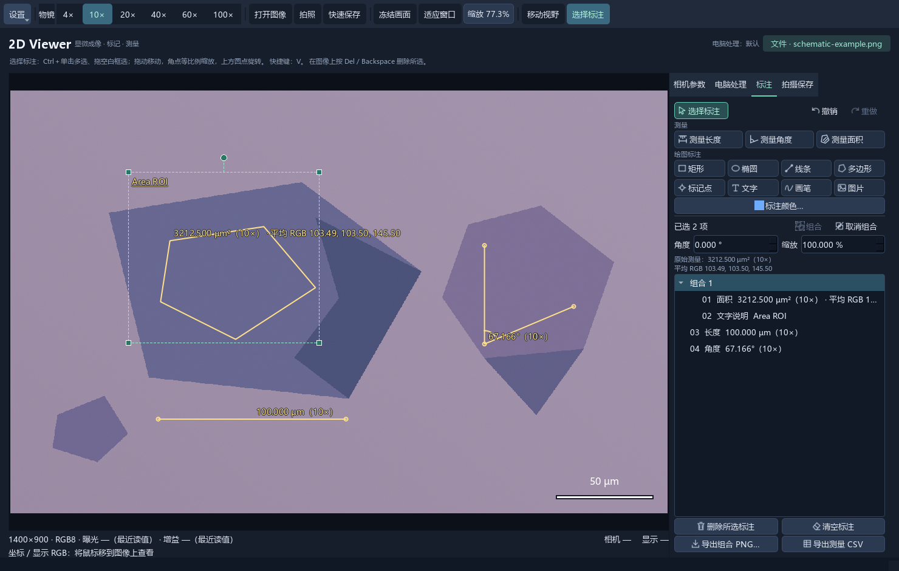
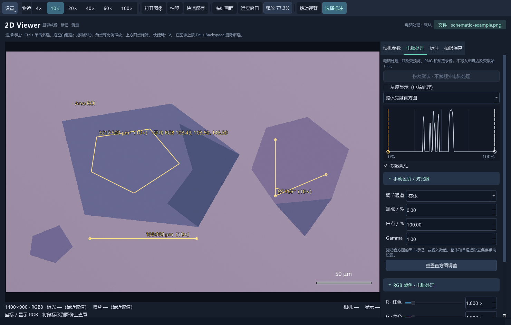

# 2D Viewer

**面向二维材料研究的显微图像采集、标注与测量工具。**

[English](README.en.md) · **简体中文**

在同一个窗口中完成显微图像查看、薄片区域圈选、平均 RGB 统计、长度／面积／角度测量和结果导出。支持 FLIR 相机采集，也可以打开已有图片离线使用。

**当前版本：0.14.1 · Windows 11 x64 · 当前软件界面为中文**

**[下载 Windows 安装包](https://github.com/twomatwo/2d-viewer/releases/download/v0.14.1/2D-Viewer-Setup-0.14.1-x64.exe)** · [所有发布版本](https://github.com/twomatwo/2d-viewer/releases) · [中文安装说明](https://github.com/twomatwo/2d-viewer/releases/download/v0.14.1/Installation-Guide-zh-CN.html) · [SHA256 校验文件](https://github.com/twomatwo/2d-viewer/releases/download/v0.14.1/SHA256SUMS.txt)

## 软件截图



*实际软件截图：底图为合成示意图，标定比例和读数仅用于展示操作，不代表真实材料、厚度或实测结果。截图使用隔离配置，未连接相机。*

## 适合哪些工作

- **薄片区域比较**：圈选多边形区域，同时记录几何面积和区域平均 RGB。
- **器件几何记录**：测量长度、面积及两条边的夹角，保留创建时的物镜倍率和标定。
- **实验过程标注**：添加文字、图形和图片叠加，多选组合并精确调整位置、角度和缩放。
- **结果整理与分享**：导出带标注的 PNG、测量 CSV，或只导出某个标注组合的透明背景 PNG。

## 主要功能

| 功能 | 内容 |
| --- | --- |
| 相机采集 | 面向 FLIR Blackfly S BFS-U3-51S5C-C；曝光、增益、白平衡、物镜对应的相机方案，以及拍照、录像和定时拍照。 |
| 离线查看 | 打开 PNG、JPEG、TIFF 等已有图像，在没有相机的情况下查看、处理、标注和测量。 |
| 图像处理 | 整体及 RGB 通道色阶、Gamma、颜色增益、亮度、对比度、饱和度、灰度、镜像及旋转；直方图辅助调整。 |
| 科研测量 | 长度、面积、三点角度；面积圈选同时记录平均 RGB。各测量保留创建时的倍率及标定。 |
| 图形与图片标注 | 矩形、椭圆、线条、多边形、标记点、文字、画笔和图片；支持图片透明度、多选、组合、精确旋转／缩放、撤销／重做。 |
| 导出与保存 | 带标注 PNG、保留原始像素的 TIFF、测量 CSV、仅标注的透明组合 PNG；可配置拍照目录与命名规则。 |
| 恢复与标定 | 按物镜保存标定与相机方案，自动保存标注恢复记录，支持标定库导入／导出。 |

### 图像处理界面



*同一合成示意底图的实际界面，展示直方图与处理控件；截图中的数值不用于性能或精度验证。*

## 安装与第一次使用

1. 下载 [0.14.1 Windows x64 安装包](https://github.com/twomatwo/2d-viewer/releases/download/v0.14.1/2D-Viewer-Setup-0.14.1-x64.exe)。
2. 关闭旧版程序后运行安装包，按提示完成安装。包内含 Python、程序依赖和官方 Spinnaker 4.4.0.246 离线安装程序，无需自行安装 Python；缺少相机运行库／USB3 驱动时会调用官方安装程序，可能需要管理员授权或重启。
3. 启动 **2D Viewer**。连接相机时使用 USB3 接口，并先关闭 SpinView 等占用相机的软件；没有相机也可以点击“打开图像…”离线使用。
4. 在顶栏选择实际物镜，测量前在“设置 → 物镜与标定”中完成真实标定，然后在右侧“标注”页选择测量或绘图工具。

安装包面向 **Windows 11 x64**，相机采集围绕 **FLIR BFS-U3-51S5C-C** 开发；其他相机型号兼容性尚未确认。当前版本已完成打包功能检查和实际 EXE 离线启动验证，尚未完成全新电脑首次驱动安装验收。

## 测量与数据说明

- 平均 RGB 来自完成圈选时的**底图显示像素**，范围为 0–255，包含电脑端处理，不包含叠加标注；包含区域边界像素。它是颜色统计，不是自动材料识别或厚度反演结果。
- 长度和面积的物理单位依赖真实标定；没有标定时使用像素单位。角度采用三点中的第二点为顶点，显示 0°–180° 夹角。
- 测量值、标定及 RGB 统计随创建时的记录固定保存。后续移动、旋转、缩放标注不会重新计算原始结果。
- 原始 TIFF 保留原始像素；选择保存标注时，将标注信息写入文件记录，不绘入原始像素。
- 更新安装保留已有设置和照片，安装版数据继续位于 `%LOCALAPPDATA%\LabView`。自动恢复记录由配对的 TIFF／JSON 组成，备份时请一起保留。

## 从源码运行

源码包为根目录的 `twodviewer/`。需要 Python 3.12 x64、项目依赖和匹配的官方 PySpin wheel；准备方法见 [相机依赖说明](docs/camera-dependencies.md)。以下命令在仓库根目录执行：

```powershell
powershell.exe -NoProfile -ExecutionPolicy Bypass -File .\setup.ps1 -PySpinWheel "C:\path\to\spinnaker_python-4.4.0.246-cp312-cp312-win_amd64.whl"
.\.venv\Scripts\python.exe -m twodviewer --no-connect
```

连接真实相机时使用 `--connect`。本机已有环境可继续通过 `Start 2D Viewer.cmd` 启动。

## 文档与反馈

- [完整使用说明](docs/usage.md)
- [相机依赖与 SDK 许可证说明](docs/camera-dependencies.md)
- [Windows 安装包构建](packaging/README.md)
- [开发维护说明](docs/development.md)
- [问题反馈与功能建议](https://github.com/twomatwo/2d-viewer/issues)

反馈问题时，请提供软件版本、Windows 版本、相机型号（如使用采集）、复现步骤和错误信息。分享截图或日志前，请移除不希望公开的实验数据及个人信息。
